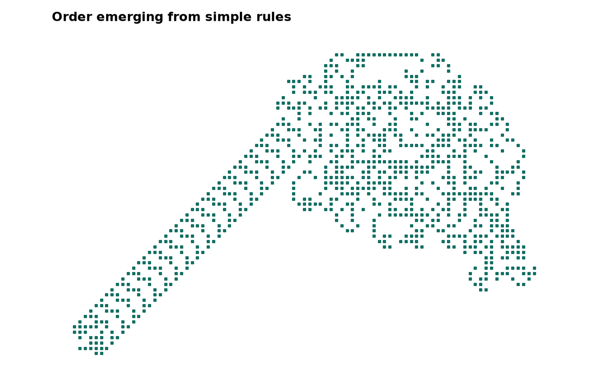

# Simulation Gallery

A visual collection of probability, stochastic-process, and emergence experiments. Six reproducible Python models generate the gallery figures; the original classroom exercises are preserved with their comments and citations.



## Explore

| Experiment | Question | Model |
|---|---|---|
| Monty Hall | Does switching help? | Stay ≈ 1/3; switch ≈ 2/3 |
| Random walk | What changes when steps favor one direction? | Mean absolute displacement across 1,000 walkers |
| Monte Carlo π | Can random points estimate a geometric constant? | Four times the fraction inside a quarter circle |
| Expected value | How does an average stabilize? | Running mean of fair six-sided die rolls |
| Langton’s ant | Can simple rules produce structure? | Two-state square-grid ant |
| Hexagonal ant | What happens on a different lattice? | Seven-state, six-direction extension |

Open `docs/index.html` in a browser, or serve it locally:

```sh
python -m http.server 8000 --directory docs
```

Then visit http://localhost:8000. This gallery is static and needs no account, API key, or JavaScript framework. GitHub Pages can serve the `docs/` directory if enabled in repository settings.

## Reproduce the figures

Python 3.10+ is recommended.

```sh
python -m venv .venv
source .venv/bin/activate  # Windows: .venv\Scripts\activate
python -m pip install -r requirements.txt
python -m simulations --seed 42 --output docs/assets
python -m unittest discover -s tests
```

The runner saves six PNGs without opening a GUI. Seed 42 reproduces the numerical samples; image rendering may differ slightly between library versions. Change `--seed` to compare random realizations. Ant models are deterministic.

## Repository structure

```text
simulations/       Seeded models and command-line figure generator
exercises/         Original exercises, including blackjack class progression
docs/index.html    Browsable static gallery
docs/assets/       Generated figures and original GIF animations
tests/             Probability and deterministic-state checks
requirements.txt   Python dependencies
```
